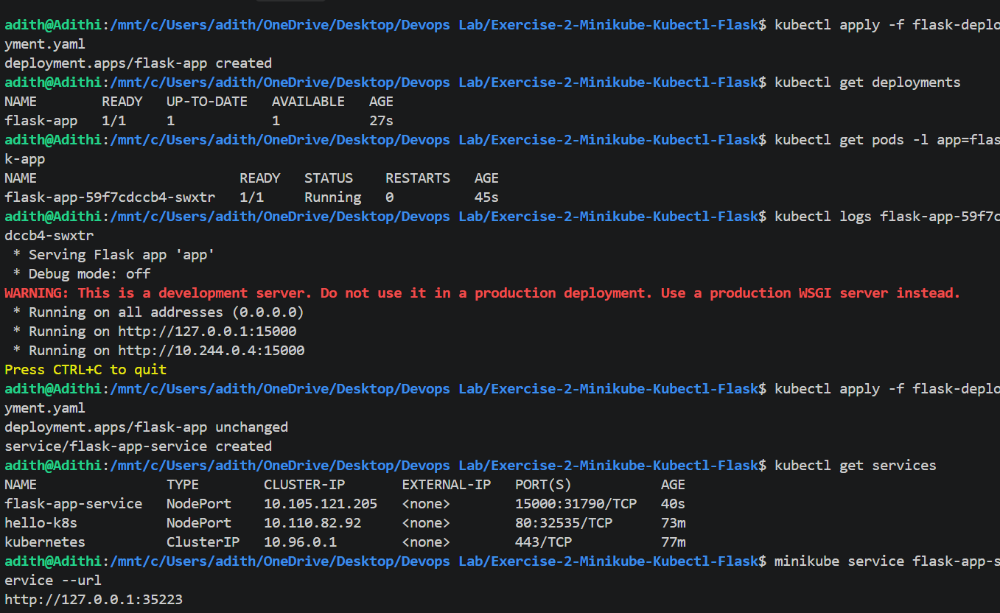

# Exercise 2: Deploy a Flask App on Minikube

## Objective
Deploy a simple Python Flask web application on a local Kubernetes cluster using Minikube, Docker, `kubectl`, and YAML configuration.

## Technologies Used
- Python and Flask
- Docker
- Kubernetes
- Minikube
- kubectl
- YAML

## Application
The Flask application runs on port `15000` and returns the following response at the root endpoint:

`Hello from Flask on Kubernetes!`

## Project Files
- `app.py` — Flask web application.
- `Dockerfile` — Instructions to build the Docker image.
- `flask-deployment.yaml` — Kubernetes Deployment and NodePort Service configuration.

## Steps Performed
1. Created a Flask application that listens on `0.0.0.0:15000`.
2. Built the Docker image using `docker build -t flask-app:latest .`.
3. Loaded the image into Minikube using `minikube image load flask-app:latest`.
4. Created a Kubernetes Deployment with one replica.
5. Exposed the application using a NodePort Service.
6. Verified the Deployment and Pod status using `kubectl`.
7. Accessed the application through the URL provided by `minikube service flask-app-service --url`.

## Useful Commands

```bash
docker build -t flask-app:latest .
minikube image load flask-app:latest
kubectl apply -f flask-deployment.yaml
kubectl get deployments
kubectl get pods -l app=flask-app
kubectl get services
kubectl logs deployment/flask-app
minikube service flask-app-service --url
```

## Result
Successfully deployed and accessed a Flask web application running inside a Kubernetes Pod on Minikube.

## Screenshots

### Flask Application Running


### Kubernetes Pod and Service Status

